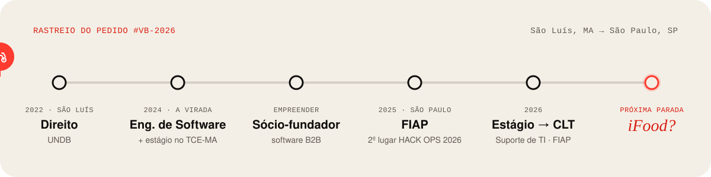

  
  
  

  <b>Estudante de Engenharia de Software na FIAP</b> (formatura nov/2028) · ex-estudante de Direito · sócio-fundador de uma empresa B2B 
  Eu não só escrevo código: <i>entendo o problema, desenho a solução e uso IA, agentes e automação para colocar no ar.</i>

 

## 🛵 Escolha o seu pedido

> Clique em um prato para abrir. Cada um foi pensado para um tipo de visita.

<b>⏱️ Tenho 30 segundos</b> (o resumo para recrutadores)

 

| | |
|---|---|
| 🎯 **Busco** | Estágio em IA generativa (AI Builder / AI Engineer) |
| 🤖 **Diferencial** | Montei uma **empresa de 9 agentes de IA** que desenvolve e opera um produto real (GED Plays) |
| 🏆 **Resultados** | 🥈 2º lugar no HACK OPS 2026 (FIAP) · Top 30 no Challenge FIAP 2025 · 4 produtos no ar |
| 🧠 **Base** | Engenharia de Software + Product Management e AI Product Builder (PM3) |
| 🗣️ **Soft skills** | Vim do Direito: falo com negócio, jurídico, finanças e tecnologia |
| 📍 **Onde** | São Paulo, SP · disponível para 30h semanais |

👉 A versão completa, com animações, está em **[vitor-bordalo.vercel.app](https://vitor-bordalo.vercel.app)**.

<b>🤖 Quero ver IA e agentes</b> (o prato principal)

 

### GED Plays: eu não montei um sistema, montei uma empresa de agentes

O **GED Plays** (Plays Tech) é um sistema de Gestão Eletrônica de Documentos para prefeituras e órgãos públicos. Tem multi-organização, permissões por pasta, perfis, fluxo de aprovação, trilha de auditoria e upload para o Google Cloud Storage.

O diferencial é **quem constrói**. Uma equipe de 9 agentes do Claude Code, cada um com um cargo, opera como uma empresa. Eu falo com ela **por e-mail**. Ela planeja, codifica, revisa, testa e me manda relatório três vezes por dia. Nada vai para produção sem um `APROVO #id` meu.

**O que aprendi:** IA é multiplicador de força, governança vem antes de autonomia, e contexto (backlog, memória, manuais) é produto.

🔗 [Abrir a demo do GED](https://ged-plays-demo.vercel.app)

### Outros pratos com IA
- 🥈 **Monitor IA**: chatbot com Llama 3.3 (Groq API) que responde dúvidas dos monitores da FIAP a partir de uma base em Markdown. 2º lugar no HACK OPS 2026.
- 💬 **Sinapse**: caixa de entrada única para o WhatsApp e o Instagram de PMEs, construída com um protocolo de agentes (`PLANO.md` + `CLAUDE.md`) que mantém o contexto entre sessões.
- 🏗️ **[Techint AI Assistant](https://github.com/vitorbordalo/techint-ia-projeto)**: consulta técnica com busca semântica sobre relatórios de engenharia.

<b>🧑‍💻 Quero ver código</b> (repositórios em destaque)

 

| Projeto | O que é | Stack |
|---|---|---|
| 🌐 **[portfolio](https://github.com/vitorbordalo/portfolio)** | Meu portfólio, contado como um pedido sendo entregue | HTML · CSS · GSAP · Lenis |
| 🏗️ **[techint-ia-projeto](https://github.com/vitorbordalo/techint-ia-projeto)** | Assistente de IA com busca semântica sobre relatórios técnicos | Python · IA |
| 📊 **[cp1-dashboard](https://github.com/vitorbordalo/cp1-dashboard)** | Reclamações bancárias com estatística inferencial (Welch, ANOVA, regressão) | Python · Pandas · Streamlit |
| 🌍 **[cp2-ai-index](https://github.com/vitorbordalo/cp2-ai-index)** | Dashboard interativo do Global AI Index | Streamlit · Plotly |
| 🌪️ **[aether-dynamic-programming](https://github.com/vitorbordalo/aether-dynamic-programming)** | Monitoramento de riscos ambientais com grafos e algoritmos | Python · Grafos |
| 🔊 **[quietoffice-gs2-edge](https://github.com/vitorbordalo/quietoffice-gs2-edge)** | Monitor de ruído com ESP32, FIWARE e display OLED | C++ · IoT |
| 🔎 **[Achados e Perdidos FIAP](https://achados-e-perdidos-fiap.vercel.app)** | Produto próprio no ar: o monitor cadastra e o aluno consulta de longe | Next.js · Supabase |

<b>🎲 Quero me divertir</b> (2 verdades e 1 mentira)

 

Uma dessas frases é mentira. Qual?

1. Antes de programar, eu estudava **Direito**.
2. Tenho uma **equipe de agentes de IA** que me manda relatório por e-mail às 9h, 13h e 18h.
3. Este README foi escrito **sem nenhuma ajuda de IA**.

<b>👀 Ver resposta</b>

 

**A mentira é a 3.** Este perfil (e as animações dele) foi feito com Claude Code, do mesmo jeito que eu construo todo o resto. Usar IA como alavanca é o meu jeito de trabalhar. 😄

 

## 📍 Rastreio do pedido

## 🍽️ Cardápio de ingredientes

| | |
|---|---|
| **IA generativa** |     |
| **Automação** |    |
| **Construção com IA** |      |
| **Desenvolvimento** |       |
| **Dados** |     |
| **Produto** |    |

## 🐍 Minha cobrinha está com fome

<picture>
  <source media="(prefers-color-scheme: dark)" srcset="https://raw.githubusercontent.com/vitorbordalo/vitorbordalo/output/snake-dark.svg"/>
  <source media="(prefers-color-scheme: light)" srcset="https://raw.githubusercontent.com/vitorbordalo/vitorbordalo/output/snake-light.svg"/>
  
</picture>

Ela é gerada todo dia por um GitHub Action. Quanto mais eu commito, mais ela come.

 

  <a href="https://vitor-bordalo.vercel.app"><b>🛵 Finalizar pedido → vitor-bordalo.vercel.app</b></a>

