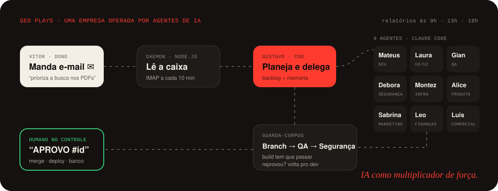

<a href="https://vitor-bordalo.vercel.app">
  
</a>

<p align="center">
  <a href="https://vitor-bordalo.vercel.app"></a>
  <a href="https://www.linkedin.com/in/vitor-bordalo-60b516287"></a>
  <a href="mailto:vitorbordalo0@gmail.com"></a>
</p>

<p align="center">
  Estudante de <b>Engenharia de Software na FIAP</b> · ex-estudante de Direito · sócio-fundador de uma empresa B2B<br/>
  <i>Eu não só escrevo código: entendo o problema, desenho a solução e uso IA, agentes e automação para colocar no ar.</i>
</p>

<br/>

## 🎮 Jogue contra o meu bot

Clique em uma casa livre ⬜. Isso abre uma issue já preenchida: é só confirmar. Um **GitHub Action** lê a sua jogada, o bot responde usando **minimax** e este README é atualizado sozinho em uns 30 segundos.

<!-- TTT:START -->
<table align="center">
    <tr><td align="center" width="64" height="64"><h3>⭕</h3></td><td align="center" width="64" height="64"><h3><a href="https://github.com/vitorbordalo/vitorbordalo/issues/new?title=ttt%7Cmove%7C2&body=S%C3%B3+clique+em+%22Create%22.+O+bot+responde+em+uns+30+segundos.+%F0%9F%A4%96" title="Jogar na casa 2">⬜</a></h3></td><td align="center" width="64" height="64"><h3><a href="https://github.com/vitorbordalo/vitorbordalo/issues/new?title=ttt%7Cmove%7C3&body=S%C3%B3+clique+em+%22Create%22.+O+bot+responde+em+uns+30+segundos.+%F0%9F%A4%96" title="Jogar na casa 3">⬜</a></h3></td></tr>
    <tr><td align="center" width="64" height="64"><h3><a href="https://github.com/vitorbordalo/vitorbordalo/issues/new?title=ttt%7Cmove%7C4&body=S%C3%B3+clique+em+%22Create%22.+O+bot+responde+em+uns+30+segundos.+%F0%9F%A4%96" title="Jogar na casa 4">⬜</a></h3></td><td align="center" width="64" height="64"><h3>❌</h3></td><td align="center" width="64" height="64"><h3><a href="https://github.com/vitorbordalo/vitorbordalo/issues/new?title=ttt%7Cmove%7C6&body=S%C3%B3+clique+em+%22Create%22.+O+bot+responde+em+uns+30+segundos.+%F0%9F%A4%96" title="Jogar na casa 6">⬜</a></h3></td></tr>
    <tr><td align="center" width="64" height="64"><h3><a href="https://github.com/vitorbordalo/vitorbordalo/issues/new?title=ttt%7Cmove%7C7&body=S%C3%B3+clique+em+%22Create%22.+O+bot+responde+em+uns+30+segundos.+%F0%9F%A4%96" title="Jogar na casa 7">⬜</a></h3></td><td align="center" width="64" height="64"><h3><a href="https://github.com/vitorbordalo/vitorbordalo/issues/new?title=ttt%7Cmove%7C8&body=S%C3%B3+clique+em+%22Create%22.+O+bot+responde+em+uns+30+segundos.+%F0%9F%A4%96" title="Jogar na casa 8">⬜</a></h3></td><td align="center" width="64" height="64"><h3><a href="https://github.com/vitorbordalo/vitorbordalo/issues/new?title=ttt%7Cmove%7C9&body=S%C3%B3+clique+em+%22Create%22.+O+bot+responde+em+uns+30+segundos.+%F0%9F%A4%96" title="Jogar na casa 9">⬜</a></h3></td></tr>
</table>
<p align="center"><b>0</b> partidas · 🤖 <b>0</b> vitórias do bot · 🤝 <b>0</b> empates · 🏆 <b>0</b> vitórias humanas</p>
<p align="center"><sub>Últimas jogadas: <a href="https://github.com/vitorbordalo">@vitorbordalo</a> jogou na casa 5</sub></p>
<!-- TTT:END -->

<details>
<summary><sub>⚙️ Como isso funciona por baixo?</sub></summary>
<br/>

```
você clica ⬜  →  issue "ttt|move|5"  →  GitHub Action dispara
   →  valida a jogada  →  bot calcula a resposta (minimax, invencível)
   →  atualiza game/state.json + README  →  comenta e fecha a issue
```

Nenhum servidor, nenhum custo: só GitHub Actions. Ao jogar, o seu login público do GitHub aparece na lista de últimas jogadas. O código está em [`.github/scripts/ttt.js`](.github/scripts/ttt.js), e o bot foi testado contra todas as 489 partidas possíveis sem perder nenhuma.
</details>

<br/>

## ⚡ Explore

<details>
<summary><b>⏱️ Tenho 30 segundos</b></summary>
<br/>

| | |
|---|---|
| 🎯 **Busco** | Estágio em IA generativa e produto (AI Builder / AI Engineer) |
| 🤖 **Diferencial** | Montei uma **empresa de 9 agentes de IA** que desenvolve e opera um produto real |
| 🏆 **Resultados** | 🥈 2º lugar no HACK OPS 2026 (FIAP) · Top 30 no Challenge FIAP 2025 · 4 produtos no ar |
| 🧠 **Base** | Engenharia de Software + Product Management e AI Product Builder (PM3) |
| 🗣️ **Soft skills** | Vim do Direito: falo com negócio, jurídico, finanças e tecnologia |
| 📍 **Onde** | São Paulo, SP · disponível para 30h semanais |

👉 Versão completa, com animações: **[vitor-bordalo.vercel.app](https://vitor-bordalo.vercel.app)**
</details>

<details>
<summary><b>🤖 Projeto em destaque: uma empresa operada por agentes de IA</b></summary>
<br/>

O **GED Plays** (Plays Tech) é um sistema de Gestão Eletrônica de Documentos para prefeituras e órgãos públicos. Tem multi-organização, permissões por pasta, fluxo de aprovação, trilha de auditoria e upload para o Google Cloud Storage.

O diferencial é **quem constrói**. Uma equipe de 9 agentes do Claude Code, cada um com um cargo, opera como uma empresa. Eu falo com ela **por e-mail**. Ela planeja, codifica, revisa, testa e me manda relatório três vezes por dia. Nada vai para produção sem um `APROVO #id` meu.



**O que aprendi:** IA é multiplicador de força, governança vem antes de autonomia, e contexto (backlog, memória, manuais) é produto.

🔗 [Abrir a demo do GED](https://ged-plays-demo.vercel.app)

**Outros projetos com IA**
- 🥈 **Monitor IA**: chatbot com Llama 3.3 (Groq API) que responde dúvidas dos monitores da FIAP a partir de uma base em Markdown. 2º lugar no HACK OPS 2026.
- 💬 **Sinapse**: caixa de entrada única para o WhatsApp e o Instagram de PMEs, construída com um protocolo de agentes (`PLANO.md` + `CLAUDE.md`) que mantém o contexto entre sessões.
- 🏗️ **[Techint AI Assistant](https://github.com/vitorbordalo/techint-ia-projeto)**: consulta técnica com busca semântica sobre relatórios de engenharia.
</details>

<details>
<summary><b>🧑‍💻 Quero ver código</b></summary>
<br/>

| Projeto | O que é | Stack |
|---|---|---|
| 🌐 **[portfolio](https://github.com/vitorbordalo/portfolio)** | Meu portfólio com animações guiadas pela rolagem | HTML · CSS · GSAP · Lenis |
| 🏗️ **[techint-ia-projeto](https://github.com/vitorbordalo/techint-ia-projeto)** | Assistente de IA com busca semântica sobre relatórios técnicos | Python · IA |
| 📊 **[cp1-dashboard](https://github.com/vitorbordalo/cp1-dashboard)** | Reclamações bancárias com estatística inferencial (Welch, ANOVA, regressão) | Python · Pandas · Streamlit |
| 🌍 **[cp2-ai-index](https://github.com/vitorbordalo/cp2-ai-index)** | Dashboard interativo do Global AI Index | Streamlit · Plotly |
| 🌪️ **[aether-dynamic-programming](https://github.com/vitorbordalo/aether-dynamic-programming)** | Monitoramento de riscos ambientais com grafos e algoritmos | Python · Grafos |
| 🔊 **[quietoffice-gs2-edge](https://github.com/vitorbordalo/quietoffice-gs2-edge)** | Monitor de ruído com ESP32, FIWARE e display OLED | C++ · IoT |
| 🔎 **[Achados e Perdidos FIAP](https://achados-e-perdidos-fiap.vercel.app)** | Produto próprio no ar: o monitor cadastra e o aluno consulta de longe | Next.js · Supabase |
</details>

<details>
<summary><b>🎲 2 verdades e 1 mentira</b></summary>
<br/>

Uma dessas frases é mentira. Qual?

1. Antes de programar, eu estudava **Direito**.
2. Tenho uma **equipe de agentes de IA** que me manda relatório por e-mail às 9h, 13h e 18h.
3. Este README foi escrito **sem nenhuma ajuda de IA**.

<details>
<summary><b>👀 Ver resposta</b></summary>
<br/>

**A mentira é a 3.** Este perfil, as animações e o bot do jogo da velha foram feitos com Claude Code, do mesmo jeito que eu construo todo o resto. 😄
</details>
</details>

<br/>

## 🌱 Minha trajetória, em commits


## 🧰 Stack

| | |
|---|---|
| **IA generativa** |     |
| **Automação** |     |
| **Construção com IA** |      |
| **Desenvolvimento** |       |
| **Dados** |     |
| **Produto** |    |

## 🐍 Minha cobrinha está com fome

<picture>
  <source media="(prefers-color-scheme: dark)" srcset="https://raw.githubusercontent.com/vitorbordalo/vitorbordalo/output/snake-dark.svg"/>
  <source media="(prefers-color-scheme: light)" srcset="https://raw.githubusercontent.com/vitorbordalo/vitorbordalo/output/snake-light.svg"/>
  
</picture>

<p align="center"><sub>Gerada todo dia por um GitHub Action. Quanto mais eu commito, mais ela come.</sub></p>

<p align="center">
  <a href="https://vitor-bordalo.vercel.app"><b>Ver o portfólio completo → vitor-bordalo.vercel.app</b></a>
</p>
